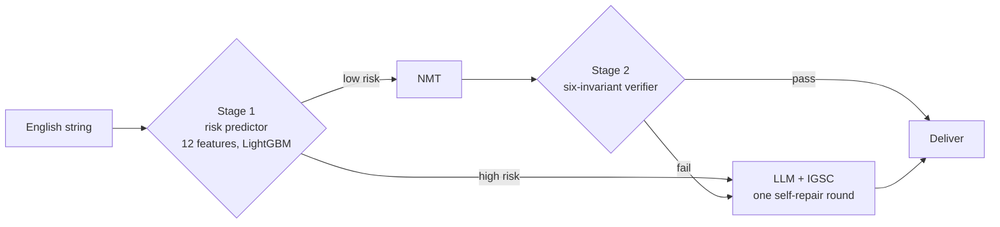

# Cost- and Risk-Aware Hybrid NMT–LLM Routing for Software Localization

An offline study of a two-stage router. For every software UI string it decides whether fast neural machine
translation (NMT) is enough, or whether the string needs a large language model (LLM) with self-correction.
The evaluation covers 10,228 KDE4 strings in 12 languages, 5 NMT systems and 5 LLMs.

**Team:** Tanish Gupta, Alok, Aayush, Akshad · BITS Pilani

---

## Motivation

UI strings carry code-like tokens that must survive translation: placeholders (`%1`, `{name}`) and keyboard
accelerators (`&File`).

| Source | Output | Problem |
|---|---|---|
| `Save as %1` | NLLB: `% 1 के रूप में सहेजें` | Placeholder broken; the file name is no longer inserted |
| `& find` | GPT-4o-mini: `और खोजें` ("and search") | Accelerator lost |
| `Recursion limit:` | Mistral-Nemo: `रिक्रेशन सीमा: %1` | Placeholder invented |

NMT is fast and cheap but drops such tokens. LLMs are stronger but cost about six times more per pull request
and make errors of their own. The goal is LLM-level reliability at close to NMT cost, inside a CI/CD pipeline.

## Approach



- **Stage 1** predicts from the source alone, before translation, whether NMT is likely to fail, and sends
  high-risk strings straight to the LLM.
- **Stage 2** checks the NMT output against six structural invariants:
  1. script purity;
  2. placeholder parity;
  3. accelerator kept;
  4. no encoding corruption;
  5. no conversational chatter;
  6. no untranslated copy.

  Failures escalate to the LLM.
- **IGSC** (Invariant-Guided Self-Correction) gives the LLM one repair round in which it is told which
  invariant it broke.

No translation is regenerated. Every experiment replays saved outputs from two public benchmarks at pinned
commits, and per-string quality is recomputed with CometKiwi.

## Key results

NLLB + GPT-4o-mini, 122,736 string–language pairs, corpus-aware verifier (v2):

| Policy | Strings sent to LLM | Structural pass | Mean CometKiwi | Cost per 1,000-string PR |
|---|---:|---:|---:|---:|
| NMT only | 0% | 95.85% | 0.7834 | $0.036 |
| LLM + IGSC for everything | 100% | 98.22% | 0.7877 | $0.402 |
| **Reactive cascade** (NMT → verifier → LLM) | **4.1%** | **99.03%** | 0.7838 | **$0.064** |
| **Improved router** (Experiment 6) | 9.9% | 99.03% | **0.7882** | $0.090 |

1. **A cheap deterministic gate makes NMT more reliable than an all-LLM pipeline, at about one-sixth of the
   cost.** Structural pass is +0.81 points [95% CI 0.74, 0.88]. The trade-off is slightly lower mean CometKiwi
   (−0.0038 [−0.0045, −0.0032]).
2. **NMT and LLMs fail in opposite ways.** 96% of NMT placeholder errors are omissions; LLMs hallucinate
   placeholders (Mistral-Nemo 9,820 times). One IGSC round brings every LLM below 1.6% structural defects.
3. **The original accelerator check misses tokenized accelerators.** KDE4 stores `&Close` as `& Close`, so it
   detects 1 accelerator among 10,228 sources instead of 780. A corpus-aware verifier (v2) shows systems losing
   13–78% of accelerators.
4. **The Stage 1 predictor is cheap and beats a rule baseline,** with AUC 0.972 for structural failure and 0.679
   for low quality, at 12.5 µs per string. Its bypass adds little quality, though, and lets unchecked LLM errors
   through.
5. **Gating the LLM output, predicting quality gain and reading NMT-output signals fixes this.** At equal LLM
   use this gives 11.5 fewer broken-or-poor translations per 1,000 [10.6, 12.5]. Matching all-LLM quality takes
   8% LLM use instead of 53%.
6. **Routing rarely avoids LLM cold starts in CI/CD.** 74% of 10-string PRs still need at least one LLM call,
   so escalations belong off the build's critical path.

## Experiments

| # | Question | Results |
|---|---|---|
| 0 | Can per-string CometKiwi be recovered from the benchmarks' saved outputs? | [results/00_cometkiwi_scores](results/00_cometkiwi_scores/) |
| 1 | How often does each system break placeholders, accelerators, script and format? | [results/01_structural_audit](results/01_structural_audit/) |
| 2 | Can NMT failure be predicted from the source alone? | [results/02_risk_predictor](results/02_risk_predictor/) |
| 3 | Which routing policy gives the best quality for the LLM budget? | [results/03_routing_policies](results/03_routing_policies/) |
| 4 | What does each policy cost, and how long does the build wait, per pull request? | [results/04_cicd_replay](results/04_cicd_replay/) |
| 5 | Are the differences statistically real? | [results/05_confidence_intervals](results/05_confidence_intervals/) |
| 6 | Can the router be improved? | [results/06_improved_router](results/06_improved_router/) |

[`results/README.md`](results/README.md) is the index. Each folder's README explains the question, the method,
every file and the result.

## Repository layout

| Path | Contents |
|---|---|
| `router/` | Core library: data loading (`data.py`), verifier v1/v2 (`verifier.py`), Stage 1 features (`features.py`), score identifiers (`scores.py`), output paths (`paths.py`) |
| `scripts/` | One script per pipeline step (see below) |
| `improved_router/` | Experiment 6: NMT-output features, policies, replay, blind human-evaluation sheet |
| `scoring/score_pairs.py`, `notebooks/` | Per-string CometKiwi scoring on a GPU (Google Colab) |
| `config/replay_profiles.json` | Timing and price parameters for Experiment 4, each labelled measured or assumed |
| `data/manifest/` | Stable row IDs, duplicate groups and per-catalog checksums |
| `results/` | All outputs and figures, one folder per experiment |
| `tests/` | Verifier parity, features, scoring, replay and Experiment 6 tests |
| `third_party/` | The original verifier, vendored unchanged, with its license |

## Reproducing

Requires Python 3.13. On macOS, LightGBM also needs `brew install libomp`. All outputs are committed, so any
step can be skipped.

```bash
python3 -m venv .venv && .venv/bin/pip install -r requirements.txt
bash scripts/fetch_upstream.sh               # clone both benchmarks at pinned commits, verify 176 checksums
.venv/bin/python -m pytest -q                # includes exact parity with the published audit (46,818 records)
```

**Experiment 1: structural audit** (seconds)
```bash
.venv/bin/python scripts/build_manifest.py
.venv/bin/python scripts/run_audit.py
.venv/bin/python scripts/exp1_report.py
```

**Experiment 0: per-string CometKiwi** (GPU, about 1.5 h on a free Colab T4)
```bash
.venv/bin/python scripts/export_pairs.py     # 692,115 distinct pairs -> scoring/data/
# Upload scoring/score_pairs.py and scoring/data/ to Google Drive and run notebooks/cometkiwi_scoring.ipynb
# (instructions inside), then copy the scores folder to scoring/scores/
.venv/bin/python scripts/join_scores.py      # map scores to 1,779,672 rows; check all 174 published means
```

**Experiments 2–5** (about 15 min)
```bash
.venv/bin/python scripts/build_dataset.py    # results/datasets/router_dataset.csv.gz
.venv/bin/python scripts/train_router.py     # Experiment 2
.venv/bin/python scripts/policies.py         # Experiment 3
.venv/bin/python scripts/replay.py           # Experiment 4
.venv/bin/python scripts/bootstrap.py        # Experiment 5
```

**Experiment 6** (about 25 min)
```bash
.venv/bin/python improved_router/run_models.py
.venv/bin/python improved_router/run_policies.py
.venv/bin/python improved_router/run_replay.py
```

Experiments 3, 4 and 6 run with both verifier versions as the safety gate, and their outputs are suffixed
`_v1` / `_v2`.

## Data sources

| Repository | Commit | Used for |
|---|---|---|
| [cloud-native-nmt-benchmark](https://github.com/Research-SoftwareLocalization/cloud-native-nmt-benchmark) | `05a411a` | 54 NMT catalogs: Google, Microsoft, NLLB-600M, MADLAD-3B, IndicTrans2 |
| [cloud-native-llm-benchmark](https://github.com/Research-SoftwareLocalization/cloud-native-llm-benchmark) | `6f31ddd` | 120 LLM catalogs (GPT-4o-mini, Llama-3.1-8B, Gemma-2-9B, Mistral-Nemo, Qwen2.5-7B; baseline and IGSC-repaired) and the six-invariant verifier |

Both use the same 10,228 OPUS KDE4 English strings (SHA-256 `464d6582…`) and 12 target languages:
- Arabic, Bengali, German, Spanish, French, Hindi;
- Japanese, Marathi, Punjabi, Tamil, Telugu, Chinese.

Rows are joined by line position.

## Verifier versions

- **v1** is the original verifier, unchanged (`third_party/`). `tests/test_parity.py` shows it reproduces all
  46,818 published defect records.
- **v2** keeps the six invariants and adapts two things to this corpus:
  - **Accelerators:** v2 allows one space after `&`, accepts letters in any script, and ignores a literal `& &`
    and XML entities. Failures are split into dropped, escaped (`&amp;`) and detached.
  - **Empty outputs** are flagged.

v1 is reported as the baseline and v2 as a corpus-aware correction.

## Limitations

- **Offline replay.** Policies select saved outputs. An escalated string receives the LLM's saved
  IGSC-repaired output, which was repaired from the LLM's own first attempt, not from the NMT output.
- **Quality is measured by CometKiwi,** a reference-free estimator, and has not yet been checked by human
  raters. A blind A/B protocol is included (`improved_router/spot_check.py`).
- **Experiment 4 is a model.** It uses stated measured and assumed parameters and synthetic pull requests, not
  repository history.
- **v2's accelerator decisions** on grey cases (`Time & Date`, `&amp;`) still need a manual spot-check.

## License

The code in this repository is released under the [MIT License](LICENSE). The vendored verifier keeps its
original MIT license (`third_party/`). KDE source strings and model or service outputs keep their own terms; see each
upstream repository's `DATA_LICENSE.md`.
